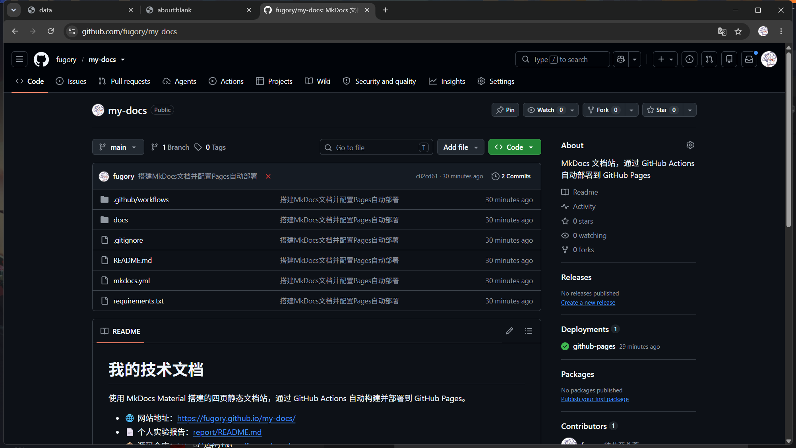
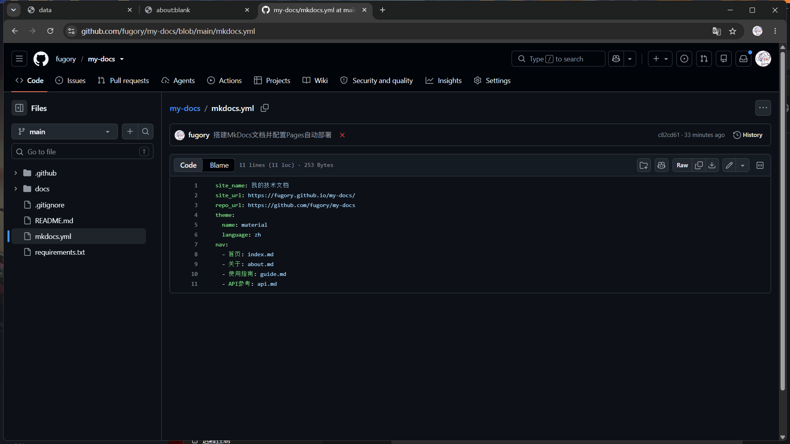
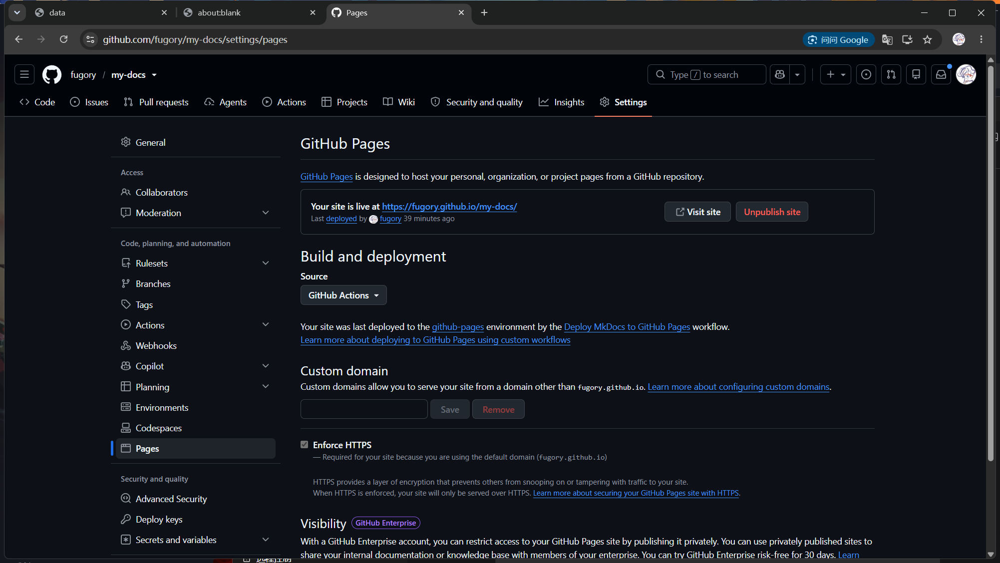
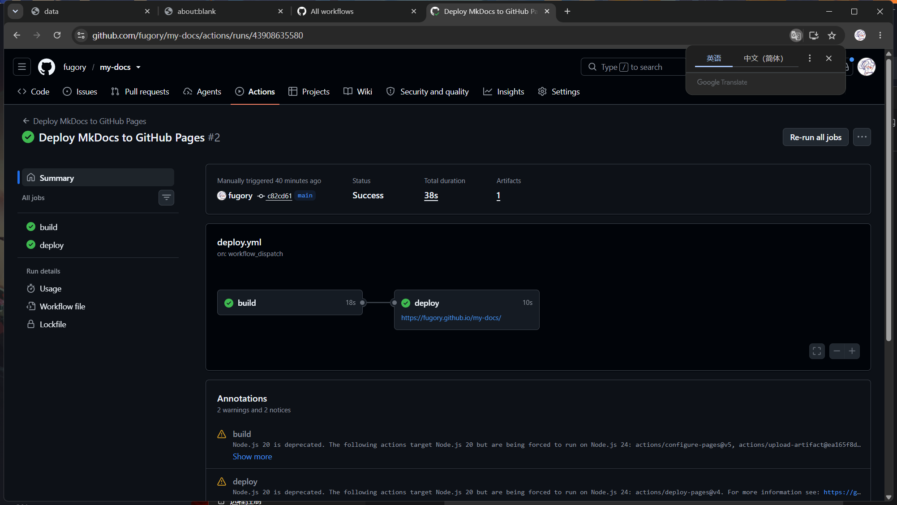
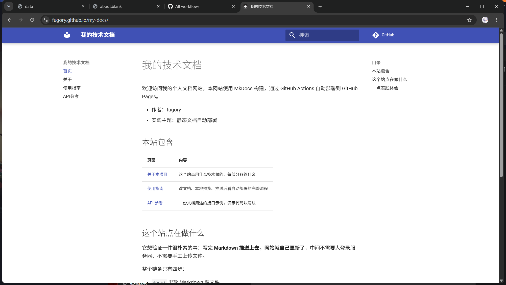
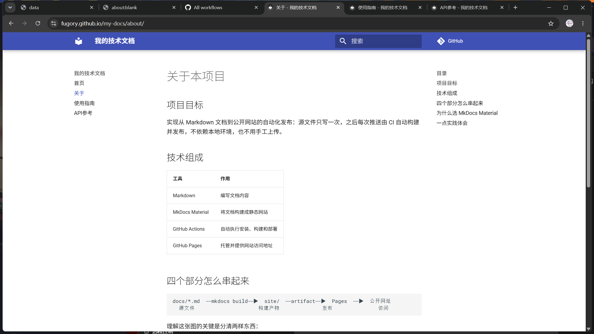
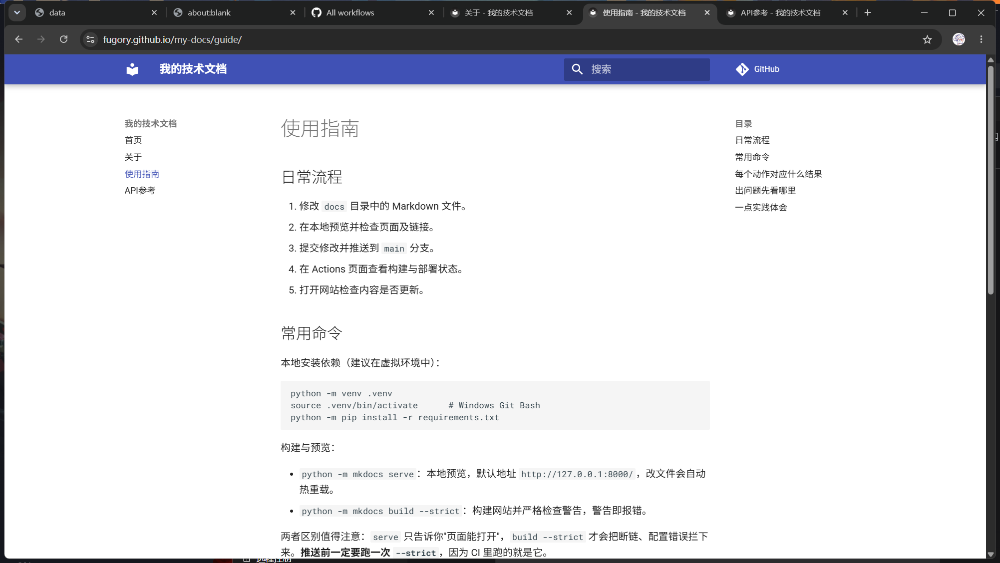
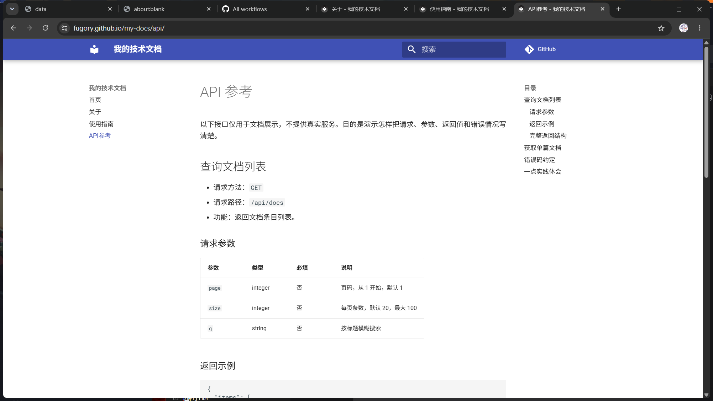
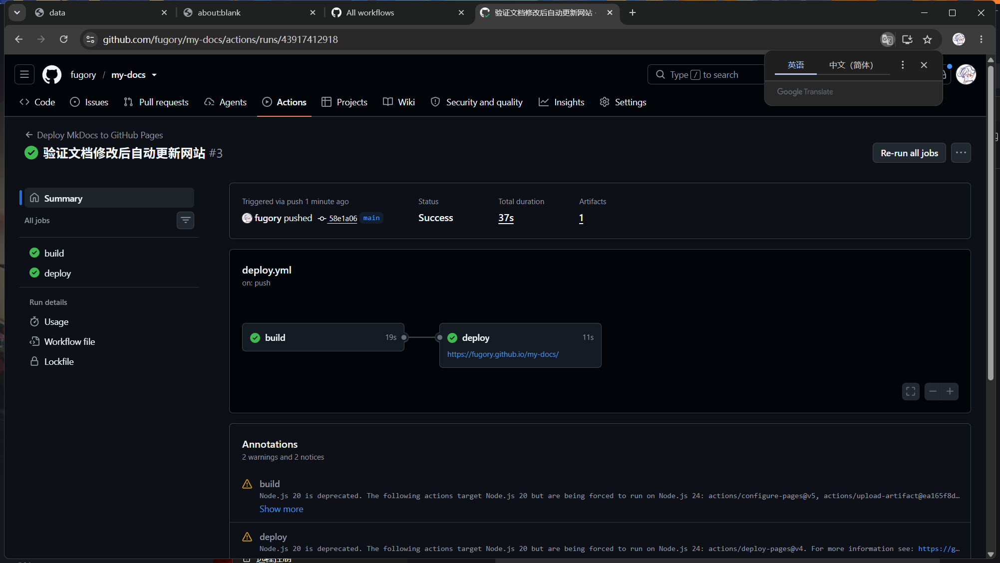
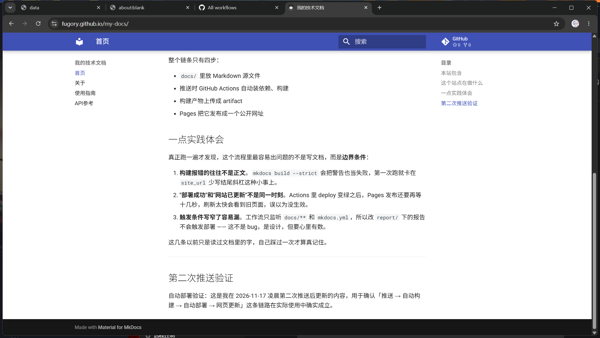

# 实践项目 2：个人实验报告

## 1. 基本信息

| 项目 | 内容 |
| --- | --- |
| GitHub 登录名 | `fugory` |
| 姓名拼音 | `fuguorui` |
| 个人仓库地址 | https://github.com/fugory/my-docs |
| 最终网站地址 | https://fugory.github.io/my-docs/ |
| 完成时间 | 2026-11-17 |

本次目标：用 MkDocs Material 搭建四页文档网站，通过 GitHub Actions 自动构建并部署到 GitHub Pages，并验证"推送文档 → 自动构建 → 自动部署 → 网页更新"这条链路真实成立。

---

## 2. 实践过程与关键截图

### 2.1 仓库创建

在本人 GitHub 账号下创建公开仓库 `my-docs`，默认分支 `main`。创建后确认三点：Owner 是本人账号、可见性为 **Public**、默认分支为 `main`（工作流里写的是 `branches: [main]`，分支名不对会导致推送不触发）。



截图说明：仓库名 `fugory / my-docs`、**Public** 标识、6 个源文件，右下角 `Deployments` 显示 `github-pages` 已部署过一次。这一步确认了"公开仓库"这个硬性要求。

### 2.2 项目结构与 MkDocs 配置

仓库根目录下的结构：

```
my-docs/
├── .github/workflows/deploy.yml   ← 工作流定义
├── docs/                          ← 网站内容（唯一内容来源）
│   ├── index.md  about.md  guide.md  api.md
├── report/                        ← 本报告及截图
├── mkdocs.yml                     ← 站点配置
├── requirements.txt               ← 依赖版本约束
└── .gitignore                     ← 排除 site/ 和 .venv/
```



截图说明：左侧文件树可见 `.github`、`docs`、`.gitignore`、`README.md`、`mkdocs.yml`、`requirements.txt`；右侧是 mkdocs.yml 全部 11 行内容。

**三个概念必须分清，这是本次理解的核心：**

- **`docs/`**：人写的 Markdown 源文件，提交进仓库，是内容的**唯一真相来源**。`nav` 里的路径都相对于它，所以写 `index.md` 而不是 `docs/index.md`。
- **`nav`**：定义左侧导航的顺序和显示名。它只影响"怎么排"，不影响"有哪些文件"——`docs/` 里存在但没进 `nav` 的页面仍会被构建，只是不出现在导航里。
- **`site/`**：`mkdocs build` 生成的**构建产物**（HTML/CSS/JS）。它是机器生成的、可以从 `docs/` 完整重建，所以**不提交**，写进 `.gitignore`。手工改 `site/` 毫无意义，下一次构建就覆盖了，而且会和源文件产生无法追溯的不一致。

`mkdocs.yml` 关键配置：

```yaml
site_name: 我的技术文档
site_url: https://fugory.github.io/my-docs/
repo_url: https://github.com/fugory/my-docs
theme:
  name: material
  language: zh
nav:
  - 首页: index.md
  - 关于: about.md
  - 使用指南: guide.md
  - API参考: api.md
```

`site_url` 必须写**带仓库路径的完整地址**并保留结尾斜杠，否则构建出的站内链接和 sitemap 会指向错误的根路径。

### 2.3 本地构建

> **说明**：作业要求 Python 3.12。本机只装了 Python 3.14 和 3.11，没有 3.12，因此本地使用 **3.11** 建虚拟环境完成构建验证；GitHub Actions 中通过 `actions/setup-python` 使用 **3.12.16** 构建，两边都通过。

本机实际执行的命令与输出（原文照录）：

```
PS D:\dsh\projects\my-docs> python -m mkdocs --version
python -m mkdocs, version 1.6.1 from .venv\Lib\site-packages\mkdocs (Python 3.11)
PS D:\dsh\projects\my-docs> python -m mkdocs build --strict
INFO    -  Cleaning site directory
INFO    -  Building documentation to directory: D:\dsh\projects\my-docs\site
INFO    -  Documentation built in 0.28 seconds

退出码: 0
```

截图③（本地构建终端截图）**未单独提供**，以上述真实输出原文代替。构建结果为退出码 0，产物 51 个文件，与 CI 日志一致。

**检查了哪些内容：**

- `--strict` 模式下警告即失败，构建通过说明**没有失效的内部链接、没有 nav 指向不存在的文件、没有 YAML 配置错误**。
- 产物 `site/` 下生成了 `index.html`、`about/`、`guide/`、`api/`、`assets/`、`search/`、`sitemap.xml`，结构完整。
- 随后在浏览器中打开线上站点逐页核对渲染效果（见 2.6）。

### 2.4 Pages 设置

进入 `Settings → Pages → Build and deployment`，把 **Source 设为 `GitHub Actions`**。



截图说明：页面显示 `Your site is live at https://fugory.github.io/my-docs/`、**Source: GitHub Actions**、`Last deployed by fugory`，以及 `Your site was last deployed to the github-pages environment by the Deploy MkDocs to GitHub Pages workflow`。

按作业要求，本方案**没有**创建 `gh-pages` 分支，也**没有**开启"Allow GitHub Actions to create and approve pull requests"，更不需要申请访问令牌——部署权限由工作流里的 `pages: write` 和 `id-token: write` 直接在任务级别授予。

> ⚠️ 这一步**必须在第一次推送之前完成**。我的实际顺序是先推送、后设置，直接导致了首次运行失败，详见第 3 节。

### 2.5 Actions 首次构建与部署

首次推送后工作流自动触发，但**失败了**。修复后通过 Actions 页面的 `Run workflow` 手动重跑，成功：



截图说明：`Deploy MkDocs to GitHub Pages #2`，`Status: Success`，`Total duration 38s`，触发人 `fugory`，提交 `c82cd61`，`on: workflow_dispatch`；左侧 `build`、`deploy` 两个 job 均为绿色对勾，图中可见 `build 18s → deploy 10s`，deploy 节点下方显示发布的网址。

- 运行地址：https://github.com/fugory/my-docs/actions/runs/43908635580

### 2.6 网站访问与四页导航检查

访问 https://fugory.github.io/my-docs/ ，四页逐一打开检查，均返回正常、导航高亮正确、表格与代码块渲染无误。

**首页**（含表格、站内链接、导航）：



**关于页**（含技术组成表格、架构链路图）：



**使用指南**（含代码块、有序列表）：



**API 参考**（含请求参数表格、JSON 示例）：



四页检查结果：

| 页面 | 地址 | 导航高亮 | 表格 | 代码块 | 站内链接 |
| --- | --- | :---: | :---: | :---: | :---: |
| 首页 | `/my-docs/` | ✅ | ✅ | — | ✅ |
| 关于 | `/my-docs/about/` | ✅ | ✅ | ✅ | ✅ |
| 使用指南 | `/my-docs/guide/` | ✅ | ✅ | ✅ | ✅ |
| API 参考 | `/my-docs/api/` | ✅ | ✅ | ✅ | ✅ |

同时确认：页面左上角站点名、右上角搜索框、GitHub 图标链接（指向 `repo_url`）均正常，静态资源（CSS/JS/字体）全部加载，无 404。

### 2.7 第二次推送与自动更新验证

修改 `docs/index.md`，在末尾新增"第二次推送验证"一节，提交并推送：

```
$ git commit -m "验证文档修改后自动更新网站"
[main 58e1a06] 验证文档修改后自动更新网站
 1 file changed, 5 insertions(+), 1 deletion(-)

$ git push origin main
   c82cd61..58e1a06  main -> main
```

**这次没有点任何手动按钮**，推送后工作流自动触发：



截图说明：标题为提交信息 `验证文档修改后自动更新网站 #3`，**`Triggered via push`**、`on: push`、提交 `58e1a06`，`Status: Success`，`Total duration 37s`，build 19s → deploy 11s，两个 job 均成功。

等待约 15 秒后强制刷新网站，新增内容已出现：



截图说明：页面底部出现「第二次推送验证」章节与新增文字，右侧目录也同步出现了该条目，地址栏为 `fugory.github.io/my-docs/`。

**对应链接：**

- 第二次提交：https://github.com/fugory/my-docs/commit/58e1a06b767f8467f3271b00f4e5da7ce24e350c
- 第二次 Actions 运行：https://github.com/fugory/my-docs/actions/runs/43917412918

---

## 3. 问题与解决

### 问题一：首次运行失败，报 `Get Pages site failed`

**现象**：第一次推送后工作流自动触发，`build` 任务在 `Configure Pages` 步骤直接红色失败，`deploy` 因 `needs: build` 被跳过。

**关键日志**：

```
##[error]Get Pages site failed. Please verify that the repository has Pages enabled
and configured to build using GitHub Actions, or consider exploring the `enablement`
parameter for this action. Error: Not Found -
https://docs.github.com/rest/pages/pages#get-a-apiname-pages-site
##[error]HttpError: Not Found - https://docs.github.com/rest/pages/pages#get-a-apiname-pages-site
```

**原因**：仓库刚创建，**Pages 尚未启用**，调用 Pages API 返回 404。`actions/configure-pages` 需要先读到 Pages 站点配置，读不到就中止。注意此时报错发生在 `build` 任务里，不在 `deploy`——因为 configure-pages 被放在了 build 阶段。

**解决**：按 5.1 的设置把 Pages 的 Source 改为 `GitHub Actions`，然后到 Actions 页面点 `Run workflow` 手动重跑，`build` 与 `deploy` 均成功。

**教训**：作业里"先设 Pages、再推送"的顺序不是随手写的。若反过来做，第一次推送必然失败。更稳的顺序是：**建仓库 → 配 Pages → 写文件 → 推送**。

### 问题二：本地 pip 安装超时

**现象**：`python -m pip install -r requirements.txt` 长时间无输出，最终超时。

**原因**：本机直连 PyPI 超时（`https://pypi.org/simple/mkdocs/` 请求超时）。

**解决**：改用国内镜像源安装成功：

```
python -m pip install --index-url https://pypi.tuna.tsinghua.edu.cn/simple -r requirements.txt
```

### 问题三：本机无 Python 3.12

**现象**：`py -3.12 --version` 报 `No suitable Python runtime found`，本机只有 3.14 和 3.11。

**解决**：本地用 3.11 建虚拟环境完成构建与预览；CI 中由 `actions/setup-python` 安装并使用 3.12.16。两边构建都能通过 `--strict`，说明文档本身与 Python 小版本无关。

### 已核对过、未发现异常的地方

| 检查项 | 结果 |
| --- | --- |
| `mkdocs build --strict` | 退出码 0，无警告 |
| 工作流 YAML 缩进 | 全部空格，无 Tab |
| `site/`、`.venv/` 是否误提交 | 已在 `.gitignore` 中排除，`git status --ignored` 确认 |
| 四页是否都能访问 | 全部 HTTP 200 |
| 站内链接与导航 | 无失效链接，四页导航高亮正确 |
| 部署后的网址是否正确 | `https://fugory.github.io/my-docs/`，带仓库路径 |
| 第二次推送是否由 push 自动触发 | 是，`Triggered via push`，未点手动按钮 |

---

## 4. 原理理解

### 1. `docs/` 和 `site/` 各保存什么？为什么不用手工修改 `site/`？

`docs/` 保存**人工编写的 Markdown 源文件**，是内容的唯一来源，提交进版本库，可 diff、可 review、可回溯。

`site/` 保存 **mkdocs build 生成的静态网站产物**（HTML、CSS、JS、搜索索引）。它是 `docs/` + `mkdocs.yml` + 主题的确定性输出，每次构建都会先清空再重建。

不需要也无法手工修改 `site/` 的原因有三条：

1. **会被覆盖**。构建时第一步就是 `Cleaning site directory`，手改的内容下一次构建立刻消失。
2. **会造成源与产物不一致**。仓库里出现"产物改过、源没改"的状态时，下一个人只改源文件，两边就永久分叉，且无法从产物反推谁改了什么。
3. **它本来就不该进版本库**。产物可以随时重建，提交它只会让仓库变大、让 diff 全是噪音，所以 `.gitignore` 排除。

### 2. 本次工作流在什么情况下自动运行？

由 `on.push` 的 `branches` 和 `paths` 两个过滤条件共同决定——**两者都满足**才触发：

```yaml
on:
  push:
    branches: [main]
    paths:
      - 'docs/**'
      - 'mkdocs.yml'
      - 'requirements.txt'
      - '.github/workflows/deploy.yml'
```

即：**推送到 `main` 分支**，**且改动涉及 `docs/` 下任意文件、`mkdocs.yml`、`requirements.txt`、或工作流文件本身**，其中任意一条命中即可。

此外 `workflow_dispatch` 允许在 Actions 页面手动运行，本次排错后重跑用的就是它。

### 3. `build` 与 `deploy` 两个任务有什么区别？

| | `build` | `deploy` |
| --- | --- | --- |
| 职责 | 取源码、装 Python、装依赖、`mkdocs build --strict`、把 `site/` 上传成 artifact | 把 artifact 发布到 Pages |
| 运行环境 | `ubuntu-latest` | `ubuntu-latest` |
| 权限 | 仓库级 `contents: read` | 任务级额外授予 `pages: write`、`id-token: write` |
| 关联 | — | `needs: build`，构建失败则不执行 |
| 环境 | 无 | `environment: github-pages`，其 URL 即网站地址 |
| 本次耗时 | 18s / 19s | 10s / 11s |

分开的核心原因是**权限最小化**：构建只需要读源码，不该有发布权限。把 `pages: write` 和 `id-token: write` 只加在 `deploy` 上，构建阶段即使被注入恶意脚本也拿不到发布能力。`id-token: write` 用于 OIDC 短期令牌，替代长期访问令牌来证明身份。

`needs: build` 保证"构建不通过就不发布"，不会把错误产物推上线。

### 4. 只修改 `report/README.md` 会触发部署吗？为什么？

**不会。** 有两个原因，任一成立就足够：

1. `paths` 里只列了 `docs/**`、`mkdocs.yml`、`requirements.txt`、`.github/workflows/deploy.yml`，**没有 `report/`**，路径过滤不通过。
2. 即使不管 `paths`，`report/` 也**不在 `docs/` 里**，不会被 MkDocs 构建进网站，改它对产物没有任何影响。

这是**有意的设计**而非缺陷：报告、README 这类文件与网站内容无关，触发一次构建部署纯属浪费 CI 时间。同理，只改根目录 `README.md` 也不会触发。

### 5. 本次方案为何无需创建 `gh-pages` 分支？

传统做法是 `mkdocs gh-deploy` 把构建产物推到 `gh-pages` 分支，再由 Pages 从该分支发布。本次走的是 **GitHub 官方自定义工作流**方案，产物通过 **artifact** 传递，不经过任何分支：

```
main 分支（源码） → build 任务构建 → upload-pages-artifact 上传 site/
                                    → deploy 任务用 deploy-pages 发布 artifact → Pages 托管
```

因此不需要 `gh-pages` 分支，具体好处是：

- **不污染 Git 历史**。产物不进版本库，仓库里只有源码。
- **不需要额外权限**。传统分支发布需要 `contents: write` 才能推分支；本方案 build 阶段只需 `contents: read`，deploy 阶段用 `pages: write` + `id-token: write`。
- **不需要访问令牌**。OIDC 由 GitHub 签发短期令牌，不用手工申请 PAT，也没有密钥泄漏风险。
- **不需要创建/批准 PR 的权限**。
- **并发冲突更少**。`concurrency: group: pages` 保证同一时刻只有一次 Pages 发布，不会像分支方案那样出现推送冲突。

这个方案的限制是：必须先把 Pages 的 Source 设成 `GitHub Actions`，否则 `configure-pages` 会因读不到 Pages 站点配置而失败——也就是第 3 节记录的那个问题。

---

## 5. 附录：关键链接

| 项目 | 链接 |
| --- | --- |
| 个人仓库 | https://github.com/fugory/my-docs |
| 网站首页 | https://fugory.github.io/my-docs/ |
| 首次成功的运行（手动重跑） | https://github.com/fugory/my-docs/actions/runs/43908635580 |
| 第二次推送自动触发的运行 | https://github.com/fugory/my-docs/actions/runs/43917412918 |
| 第二次提交 | https://github.com/fugory/my-docs/commit/58e1a06b767f8467f3271b00f4e5da7ce24e350c |
| 工作流文件 | https://github.com/fugory/my-docs/blob/main/.github/workflows/deploy.yml |
